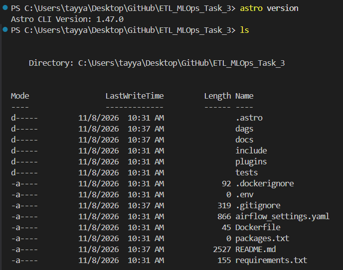
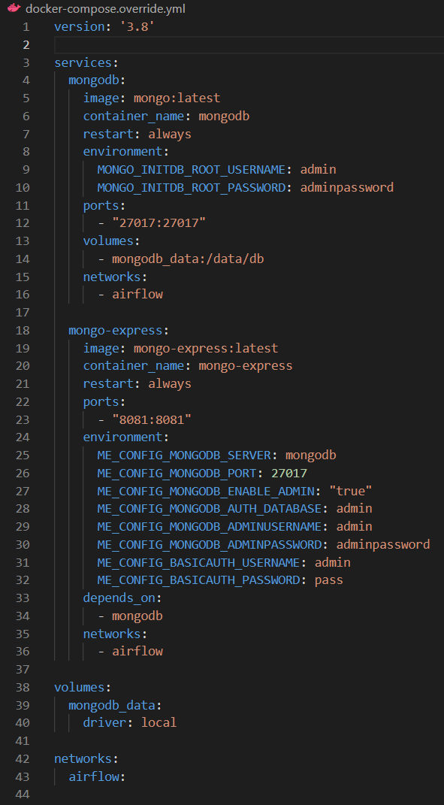
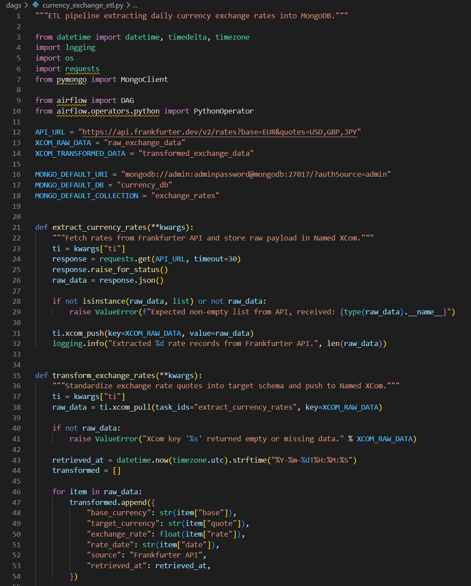
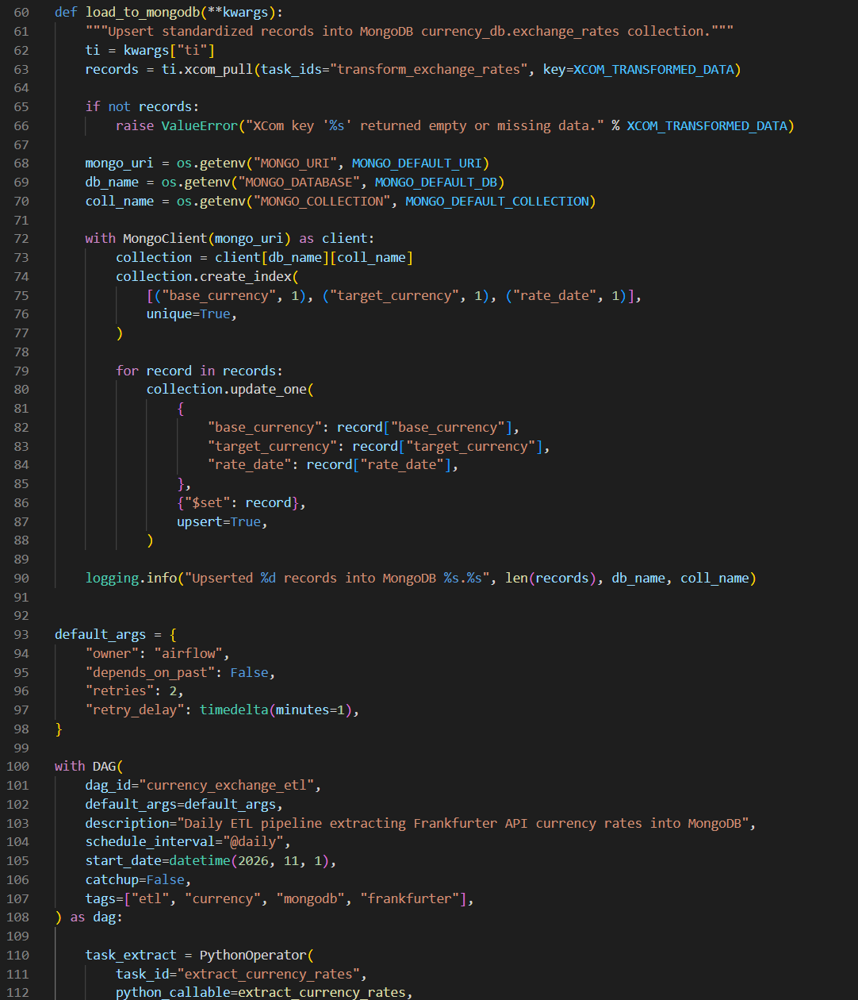
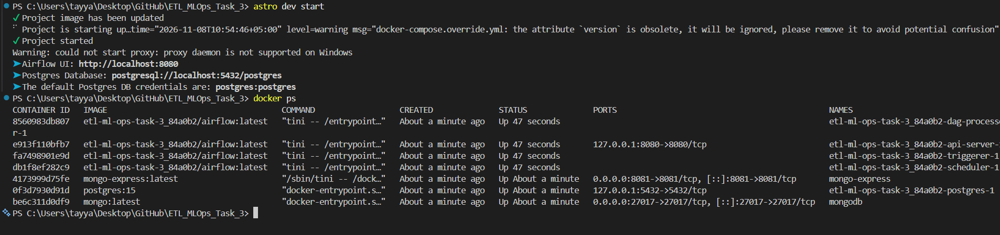
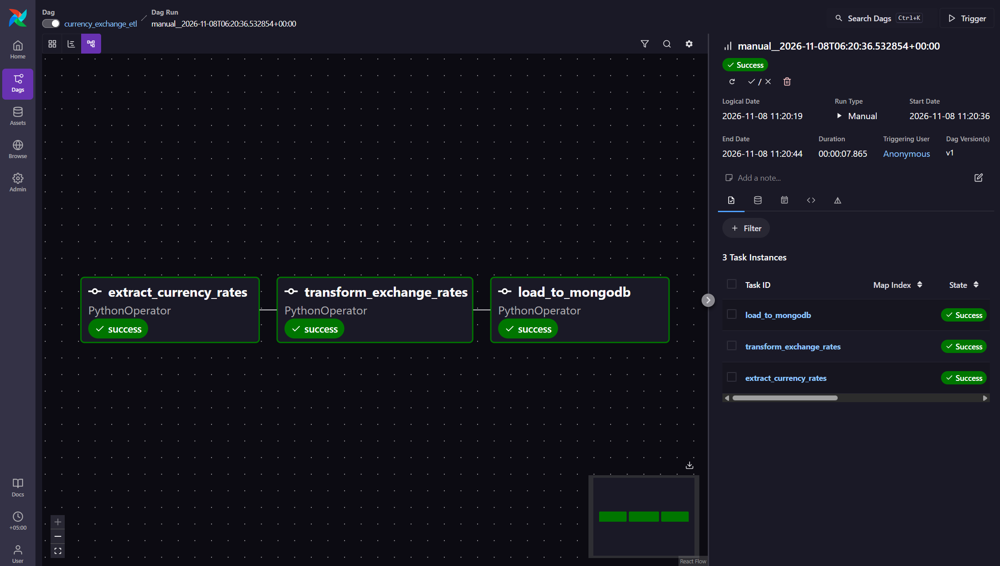
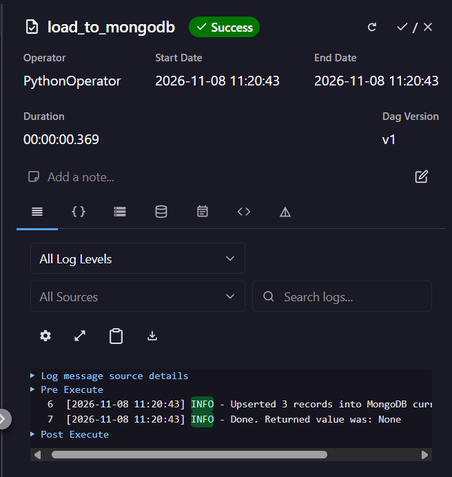
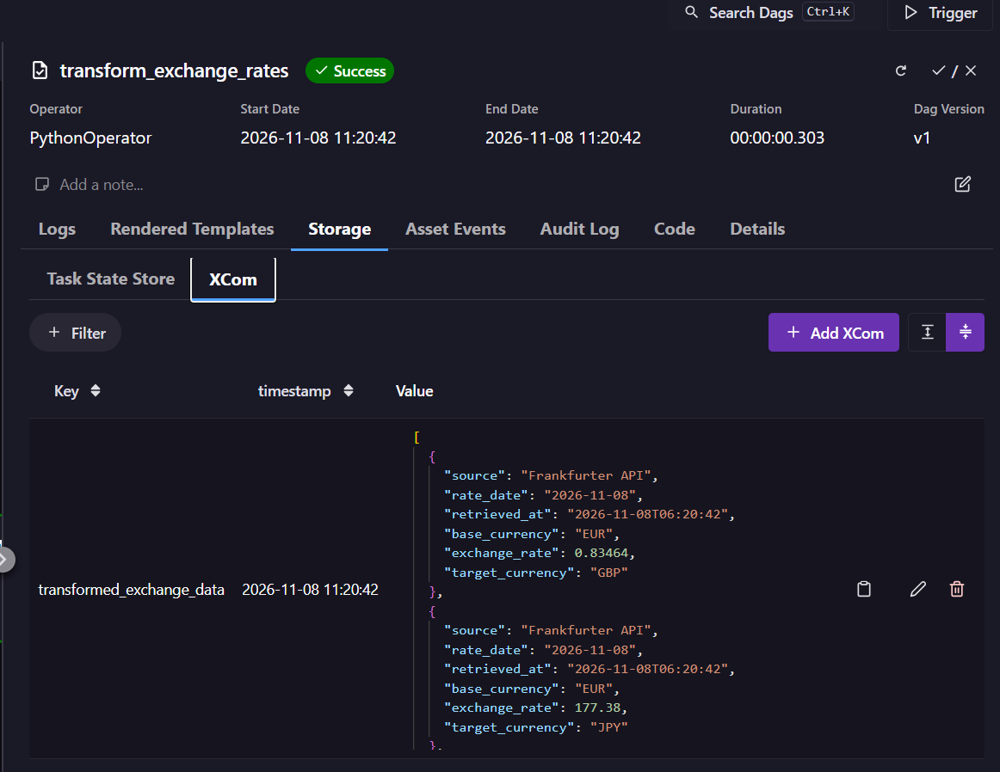
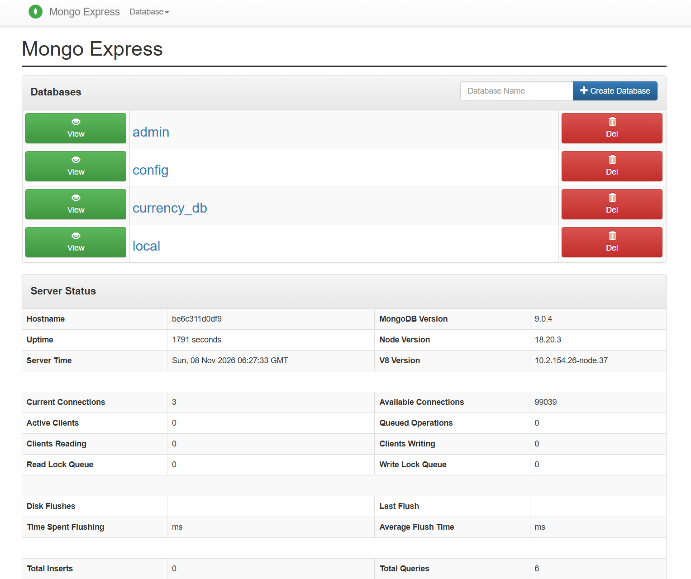
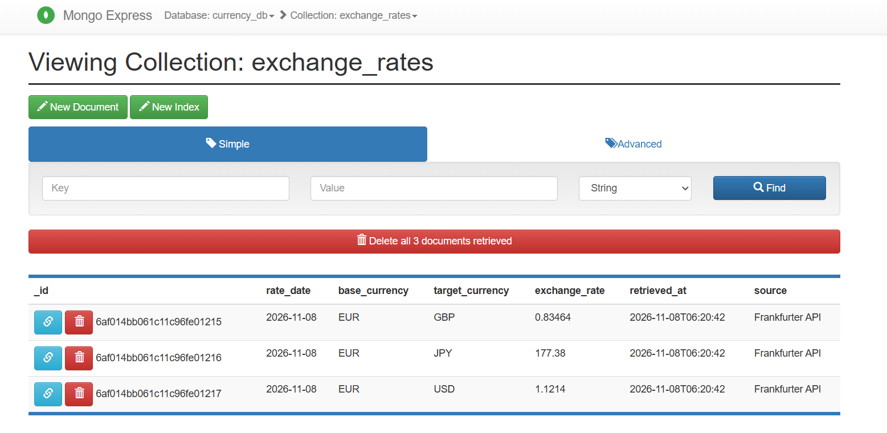

# Project Documentation & Pipeline Walkthrough

- **Repository**: [https://github.com/TayyabKhalid25/ETL_MLOps_Task_3](https://github.com/TayyabKhalid25/ETL_MLOps_Task_3)
- **Task**: MLOps Task 3 — Building Airflow ETL Pipeline
- **Orchestration**: Astronomer (Astro) CLI with Apache Airflow
- **Database**: MongoDB with Mongo Express Administration UI
- **Data Source**: [Frankfurter API v2](https://frankfurter.dev/)

---

## 1. Project Objective

The goal of this project is to build an automated daily Extract, Transform, Load (ETL) pipeline using Apache Airflow and the Astronomer (Astro) CLI. The pipeline fetches daily foreign exchange rates for Euro (`EUR`) against US Dollar (`USD`), British Pound (`GBP`), and Japanese Yen (`JPY`) from the Frankfurter API, cleans and standardizes the records into a structured JSON schema, and persists them into a MongoDB collection.

All task communication is handled through Airflow Named XComs, and database services run as containerized Docker workloads with isolated bridge networking and persistent storage.

---

## 2. Architecture & Data Flow

The pipeline executes sequentially in three stages:

1. **Extraction**: Airflow issues an HTTP GET request to the Frankfurter API endpoint and pushes the raw payload to Airflow's metadata database under the explicit XCom key `raw_exchange_data`.
2. **Transformation**: The transformation task retrieves `raw_exchange_data` from XCom, extracts each quote, casts numeric rates to float values, appends extraction timestamps in UTC ISO-8601 format, and pushes the standardized list to XCom key `transformed_exchange_data`.
3. **Loading**: The database task pulls `transformed_exchange_data`, connects to the containerized MongoDB service via Docker networking, creates a compound unique index on `(base_currency, target_currency, rate_date)`, and upserts each record into `currency_db.exchange_rates` to ensure idempotency.

```text
Frankfurter API (HTTPS)
         │
         ▼
[extract_currency_rates]
         │ (Named XCom: 'raw_exchange_data')
         ▼
[transform_exchange_rates]
         │ (Named XCom: 'transformed_exchange_data')
         ▼
[load_to_mongodb] ──> MongoDB Container (mongodb:27017, volume: mongodb_data)
                             │
                             ▼
                      Mongo Express UI (http://localhost:8081)
```

---

## 3. Step-by-Step Implementation & Verification

### Step 1: Environment Setup & Project Initialization

The project workspace was scaffolded using the Astronomer CLI (`astro dev init`). This generated the standard directory layout for Airflow configurations, DAGs, runtime dependencies, and container definitions.



*The terminal shows verification of the Astro CLI installation and the resulting directory tree containing `dags/`, `Dockerfile`, `packages.txt`, and `requirements.txt`.*

---

### Step 2: Docker Infrastructure Configuration

MongoDB and Mongo Express were integrated into the Astro CLI stack using `docker-compose.override.yml`. 

- **Custom Networking**: Both services join Astro's default `airflow` bridge network. This enables Airflow worker tasks to communicate with MongoDB directly by its service hostname (`mongodb:27017`) instead of host-level port binding.
- **Persistent Storage**: A named volume (`mongodb_data`) is mounted to `/data/db` within the MongoDB container, ensuring database records survive container restarts and rebuilds.
- **Dependency Management**: `requirements.txt` was configured with `requests` for API ingestion and `pymongo` for database interaction.



*Configuration view illustrating the service declarations for `mongodb` and `mongo-express`, volume bindings, and network settings.*

---

### Step 3: DAG Implementation & Named XCom Design

The pipeline logic was authored in `dags/currency_exchange_etl.py` using three `PythonOperator` tasks:

1. `extract_currency_rates`: Queries `https://api.frankfurter.dev/v2/rates?base=EUR&quotes=USD,GBP,JPY`, validates the HTTP response, and writes the raw list to XCom key `raw_exchange_data`.
2. `transform_exchange_rates`: Reads from `raw_exchange_data`, maps fields to the required target schema, attaches an ISO-8601 UTC timestamp, and writes the structured records to XCom key `transformed_exchange_data`.
3. `load_to_mongodb`: Reads from `transformed_exchange_data`, connects to `currency_db`, ensures an index over the unique business keys, and upserts the documents.



*Source code view showing the implementation of the extraction task, response validation, and schema mapping.*



*Source code view showing the MongoDB upsert operation inside a context manager and the linear task dependency chain (`extract >> transform >> load`).*

---

### Step 4: Environment Launch & Container Verification

Executing `astro dev start` builds the custom runtime image (installing specified Python libraries) and starts all project containers.



*Terminal output confirming active status for the Airflow components (scheduler, webserver, triggerer, metadata database), the `mongodb` service on port 27017, and `mongo-express` on port 8081.*

---

### Step 5: DAG Execution in Airflow Web UI

Accessing the Airflow Web UI at `http://localhost:8080`, the DAG `currency_exchange_etl` was triggered manually. All three sequential tasks executed and completed with status `success`.



*Airflow Graph View showing `extract_currency_rates`, `transform_exchange_rates`, and `load_to_mongodb` in dark green (`success`), validating task progression and dependency resolution.*

---

### Step 6: Task Execution Logs

Inspecting task logs from the Airflow UI confirms task execution details, network connectivity, and upsert counts.



*Logs for `load_to_mongodb` confirming 3 records were upserted into `currency_db.exchange_rates` and the task completed successfully in 0.369 seconds.*

---

### Step 7: Named XCom Data Transfer Verification

The assignment specifically requires Named XComs for inter-task communication. The XCom inspector confirms the storage of explicit keys and their corresponding structured JSON payloads.



*Airflow Task Storage tab displaying the Named XCom key `transformed_exchange_data` alongside the structured JSON array containing exchange quotes for EUR/GBP, EUR/JPY, and EUR/USD.*

---

### Step 8: Database Verification in Mongo Express

Navigating to Mongo Express at `http://localhost:8081` allows administrative inspection of the MongoDB server status, active databases, and collections.



*Mongo Express dashboard showing the active database list including `currency_db`, running on MongoDB version 9.0.4 with an active connection pool.*

---

### Step 9: Stored Document Schema Verification

Drilling into `currency_db` > `exchange_rates` displays the documents committed by the pipeline.



*Document list within `currency_db.exchange_rates` verifying that 3 daily exchange rate quotes were inserted, matching the required data structure and types.*

---

## 4. Target Schema Specification

The documents stored in MongoDB adhere to the following schema definition:

| Field | Type | Description | Sample Value |
| :--- | :--- | :--- | :--- |
| `_id` | ObjectId | MongoDB unique document identifier | `6af014bb061c11c96fe01217` |
| `base_currency` | String | Source currency code | `EUR` |
| `target_currency` | String | Target exchange currency code | `USD` |
| `exchange_rate` | Number (Float) | Rate of exchange for base against target | `1.1214` |
| `rate_date` | String | Date of the published exchange rate | `2026-11-08` |
| `source` | String | Data provider attribution | `Frankfurter API` |
| `retrieved_at` | String | Timestamp of ETL execution in UTC | `2026-11-08T06:20:42` |

---

## 5. Conclusion & Operational Benefits

- **Decoupled Architecture**: Airflow orchestrates scheduling and task execution; MongoDB provides flexible document storage; Mongo Express provides a lightweight visual inspection interface.
- **Idempotence**: The load task enforces an index on `(base_currency, target_currency, rate_date)` and uses `update_one(..., upsert=True)`. Multiple runs on the same date update existing entries without creating duplicate records.
- **Failure Isolation**: Each step executes in its own task boundary. API network interruptions fail fast at extraction without polluting downstream storage, and Named XComs provide full auditability into payloads between stages.
